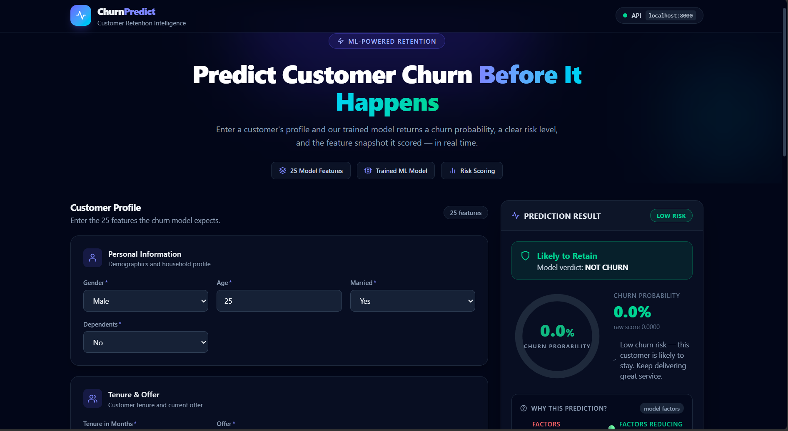
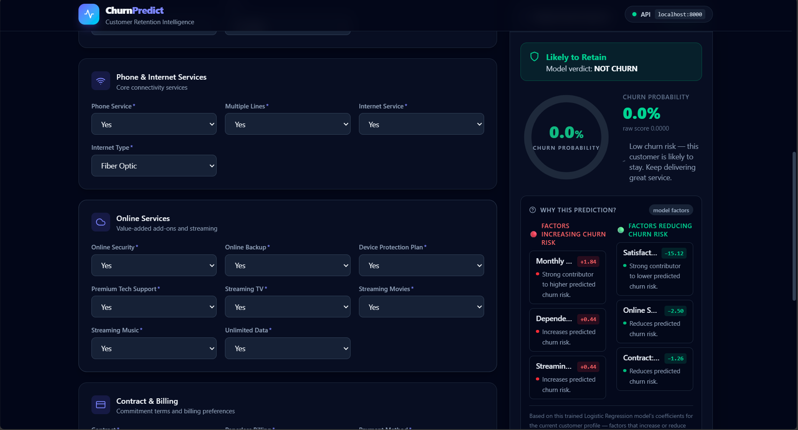
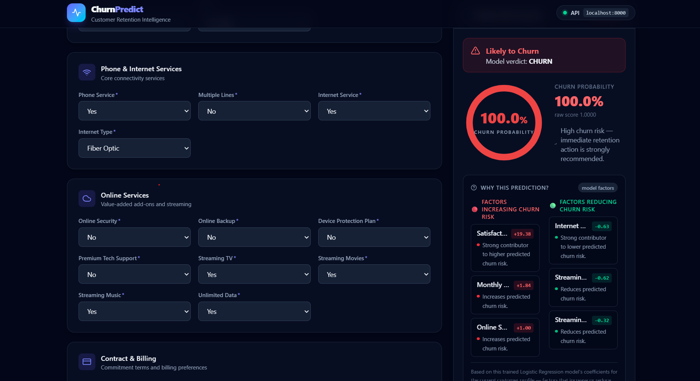
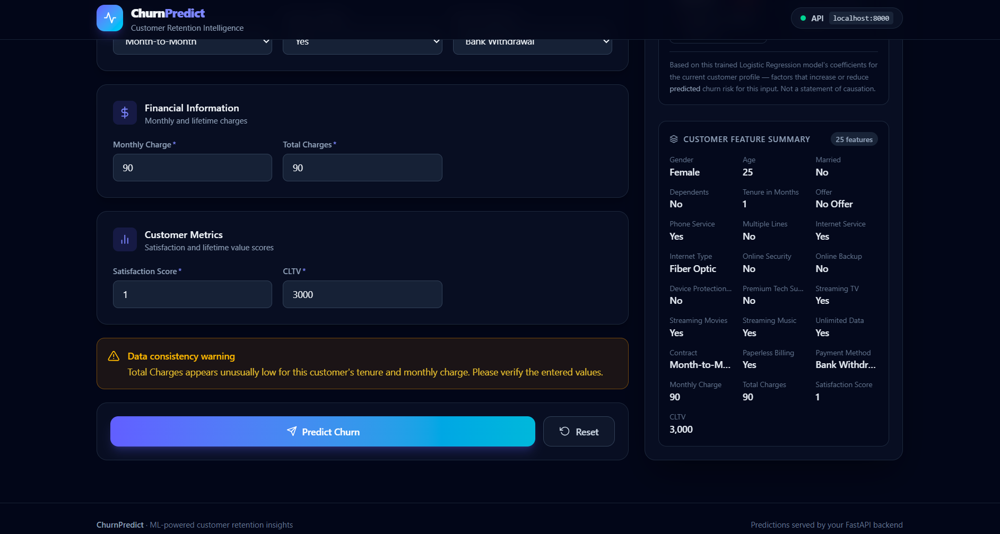

# 📊 Customer Churn Prediction & Retention Intelligence

An end-to-end **Machine Learning Customer Churn Prediction** application that predicts whether a customer is likely to leave a service. The project combines a trained Machine Learning model with a **FastAPI backend** and a **React frontend** to provide real-time churn probability, risk classification, feature-based explanations, and data-quality validation.

---

## 🚀 Project Overview

Customer churn is a major challenge for businesses because losing existing customers can directly affect revenue and growth.

This project uses customer demographic, service, contract, billing, satisfaction, and customer-value information to predict whether a customer is likely to churn.

The application provides:

- 🤖 Machine Learning-based churn prediction
- 📊 Churn probability
- 🟢 LOW / 🟡 MEDIUM / 🔴 HIGH risk classification
- 🔍 "Why This Prediction?" feature explanations
- ⚠️ Realistic-data validation
- ⚡ Real-time predictions through FastAPI
- 💻 Interactive React dashboard

---

## 🎯 Project Objectives

The main objectives of this project are:

1. Analyze customer data and identify churn patterns.
2. Build a Machine Learning model to predict customer churn.
3. Select a practical set of customer features.
4. Deploy the trained model through a FastAPI REST API.
5. Build an interactive React frontend.
6. Provide understandable explanations for model predictions.
7. Detect unrealistic combinations in customer input data.

---

## 🧠 Machine Learning Model

The final model uses **Logistic Regression**.

### Why Logistic Regression?

Logistic Regression is suitable for this problem because churn prediction is a **binary classification problem**:

- `0 → No Churn`
- `1 → Churn`

It also provides model coefficients that can be used to understand which features contribute toward churn risk.

### Hyperparameter Tuning

GridSearchCV was used to find the best value of `C`.

Tested values:

```text
0.01
0.1
1
10
100
```

The best value was:

```text
C = 10
```

The model was evaluated using **F1-score** during cross-validation because the churn classes are imbalanced.

---

## 📈 Model Performance

Final Logistic Regression model:

| Metric | Result |
|---|---:|
| Accuracy | **95.74%** |
| Churn Precision | **95%** |
| Churn Recall | **89%** |
| Churn F1-score | **92%** |
| Best C | **10** |

The model was reduced from the original feature set to **25 practical customer features** while maintaining strong predictive performance.

---

## 🔢 Features Used

The final model uses **25 input features**.

### 👤 Customer Profile

- Gender
- Age
- Married
- Dependents

### 📅 Customer Relationship

- Tenure in Months

### 📱 Services

- Phone Service
- Multiple Lines
- Internet Service
- Internet Type
- Online Security
- Online Backup
- Device Protection Plan
- Premium Tech Support
- Streaming TV
- Streaming Movies
- Streaming Music
- Unlimited Data

### 📄 Contract & Billing

- Contract
- Paperless Billing
- Payment Method
- Offer

### 💰 Financial Information

- Monthly Charge
- Total Charges

### ⭐ Customer Value & Satisfaction

- Satisfaction Score
- CLTV

---

## 🔍 Exploratory Data Analysis

Several important patterns were identified during EDA.

### Contract

Customers with month-to-month contracts showed substantially higher churn than customers with one-year or two-year contracts.

### Tenure

Customers who churned generally had much shorter tenure than customers who stayed.

### Monthly Charges

Churned customers generally had higher monthly charges.

### Internet Type

Fiber Optic customers showed a higher churn rate compared with DSL and customers without internet service.

### Online Security

Customers without Online Security showed higher churn rates.

### Payment Method

Churn rates varied across different payment methods.

These observations helped understand customer behavior and select meaningful features.

> **Note:** EDA findings show associations in the dataset and do not prove that a particular feature directly causes churn.

---

## 🔍 Model Explainability

The application includes a **"Why This Prediction?"** section.

Instead of only displaying:

```text
CHURN
99% probability
```

the application also identifies important factors contributing to the prediction.

The explanation is calculated using the Logistic Regression model's actual coefficients and the customer's transformed feature values.

Conceptually:

```text
Contribution = Transformed Feature Value × Model Coefficient
```

The application displays:

- 🔴 Factors increasing churn risk
- 🟢 Factors reducing churn risk

The top contributing features are shown to make the prediction easier to understand.

> Feature contributions represent model associations and should not be interpreted as causal relationships.

---

## ⚠️ Realistic Data Validation

The application also checks whether the customer's financial information is realistic.

For example:

```text
Tenure = 72 months
Monthly Charge = ₹90
Total Charges = ₹90
```

Expected charges:

```text
72 × ₹90 = ₹6,480
```

Since ₹90 is unusually low compared with the expected total charges, the application displays a warning.

### Important

The validation is **non-blocking**.

The user can still make the prediction after seeing the warning.

This keeps data-quality checking separate from the Machine Learning prediction logic.

---

## 🖥️ Application Screenshots

### Customer Input & Prediction Dashboard



### Low-Risk Customer Prediction



### High-Risk Customer Prediction



### Data Quality Validation



---

## 🏗️ System Architecture

```text
                    React Frontend
                         │
                         │ Customer Data
                         ▼
                 FastAPI REST API
                         │
                         ▼
              Data Preprocessing
                         │
                ┌────────┴────────┐
                │                 │
          Preprocessor          Scaler
                │                 │
                └────────┬────────┘
                         ▼
                 Logistic Regression
                         │
                         ▼
              Churn Probability
                         │
                ┌────────┴────────┐
                ▼                 ▼
           Risk Level       Feature Explanation
                │                 │
                └────────┬────────┘
                         ▼
                  React Dashboard
```

---

## 🛠️ Tech Stack

### Machine Learning

- Python
- Pandas
- NumPy
- Scikit-learn
- Joblib

### Backend

- FastAPI
- Uvicorn
- Pydantic

### Frontend

- React
- Vite
- Tailwind CSS
- Axios
- Recharts
- React Icons

### Development

- Google Colab
- VS Code
- Git
- GitHub

---

## 📁 Project Structure

```text
customer-churn-prediction/
│
├── backend/
│   ├── main.py
│   ├── churn_model.pkl
│   ├── churn_preprocessor.pkl
│   ├── churn_scaler.pkl
│   ├── requirements.txt
│   └── venv/
│
├── frontend/
│   ├── src/
│   │   ├── components/
│   │   │   ├── Header.jsx
│   │   │   ├── CustomerForm.jsx
│   │   │   ├── FormSection.jsx
│   │   │   ├── PredictionCard.jsx
│   │   │   ├── RiskMeter.jsx
│   │   │   ├── FeatureSummary.jsx
│   │   │   └── FeatureExplanation.jsx
│   │   │
│   │   ├── services/
│   │   │   └── api.js
│   │   │
│   │   ├── validation/
│   │   │   └── chargesValidation.js
│   │   │
│   │   ├── App.jsx
│   │   ├── main.jsx
│   │   └── index.css
│   │
│   ├── package.json
│   └── vite.config.js
│
├── screenshots/
│   ├── home.png
│   ├── low-risk.png
│   ├── high-risk.png
│   └── validation-warning.png
│
├── feature_reduction_colab.ipynb
├── README.md
└── .gitignore
```

---

## ⚙️ How to Run Locally

### 1. Clone the Repository

```bash
git clone https://github.com/Bs-2006/Customer-Churn-Prediction.git
cd Customer-Churn-Prediction
```

### 2. Start the Backend

Go to the backend folder:

```bash
cd backend
```

Create and activate a virtual environment:

```bash
python -m venv venv
```

Windows:

```bash
venv\Scripts\activate
```

Install dependencies:

```bash
pip install -r requirements.txt
```

Start FastAPI:

```bash
uvicorn main:app --reload --port 8000
```

The API will be available at:

```text
http://localhost:8000
```

---

### 3. Start the Frontend

Open another terminal:

```bash
cd frontend
```

Install dependencies:

```bash
npm install
```

Start the development server:

```bash
npm run dev
```

The frontend will normally be available at:

```text
http://localhost:5173
```

---

## 🔌 API

### Health Check

```http
GET /
```

Example response:

```json
{
  "status": "ok",
  "service": "Churn Prediction API",
  "features": 25,
  "model_loaded": true,
  "preprocessor_loaded": true,
  "scaler_loaded": true
}
```

### Prediction

```http
POST /predict
```

The endpoint accepts the 25 customer features and returns:

```json
{
  "prediction": "CHURN",
  "churn_probability": 0.9984,
  "risk_level": "HIGH"
}
```

---

## 🎚️ Risk Classification

The application converts the predicted churn probability into a simple risk level.

| Probability | Risk |
|---|---|
| `< 40%` | 🟢 LOW |
| `40% – 70%` | 🟡 MEDIUM |
| `> 70%` | 🔴 HIGH |

This makes the ML output easier for users to understand.

---

## 🧪 Testing

The application was tested using:

### Test 1 — Low-Risk Customer

A long-tenure customer with:

- Two-year contract
- High satisfaction
- Multiple services
- Online security
- Online backup
- Credit card payment

Result:

```text
NOT CHURN
LOW RISK
```

### Test 2 — High-Risk Customer

A customer with:

- One-month tenure
- Month-to-month contract
- Low satisfaction
- Higher monthly charge
- No online security
- Several streaming services

Result:

```text
CHURN
HIGH RISK
```

### Test 3 — Unrealistic Financial Data

A customer with:

```text
72 months tenure
₹90 monthly charge
₹90 total charges
```

Result:

```text
Validation warning displayed
Prediction still completed
```

### Test 4 — Missing Required Field

The application correctly rejects missing required inputs.

---

## 🔐 Data & Model Validation

The backend validates incoming requests using Pydantic.

Unexpected fields are rejected using:

```text
extra = "forbid"
```

The API also verifies that the expected **25 raw features** are provided.

---

## 💡 Key Learning Outcomes

Through this project, I worked with:

- Data cleaning
- Missing-value handling
- Exploratory Data Analysis
- Feature selection
- Categorical encoding
- Feature scaling
- Train-test splitting
- Class imbalance
- Logistic Regression
- Hyperparameter tuning
- Model evaluation
- Model explainability
- REST API development
- React frontend integration
- Input validation
- Git and GitHub

---

## 🔮 Future Improvements

Possible future improvements include:

- Deploy the application publicly
- Add customer retention recommendations
- Compare additional ML algorithms
- Add model monitoring
- Add authentication
- Store prediction history
- Add analytics dashboards
- Improve automated data-quality checks

---

## 📌 Project Highlights

- **25 practical customer features**
- **95.74% test accuracy**
- **92% churn F1-score**
- Logistic Regression with hyperparameter tuning
- FastAPI ML backend
- React interactive dashboard
- Real-time churn probability
- LOW / MEDIUM / HIGH risk classification
- Model-based prediction explanations
- Realistic financial-data validation

---

## 👩‍💻 Author

**Bindhu Madhavi**

B.Tech — Artificial Intelligence & Data Science

Interested in:

- Artificial Intelligence
- Machine Learning
- Software Engineering
- Full-Stack Development
- AI-powered applications

---

## ⭐ Project Goal

The goal of this project is to demonstrate how Machine Learning can be integrated into a complete software application to transform customer data into actionable churn-risk insights.

Instead of only building a model in a notebook, this project demonstrates the complete workflow:

```text
Data
 ↓
EDA
 ↓
Feature Engineering
 ↓
Machine Learning
 ↓
Model Evaluation
 ↓
Explainability
 ↓
FastAPI
 ↓
React
 ↓
Real-Time Prediction
```